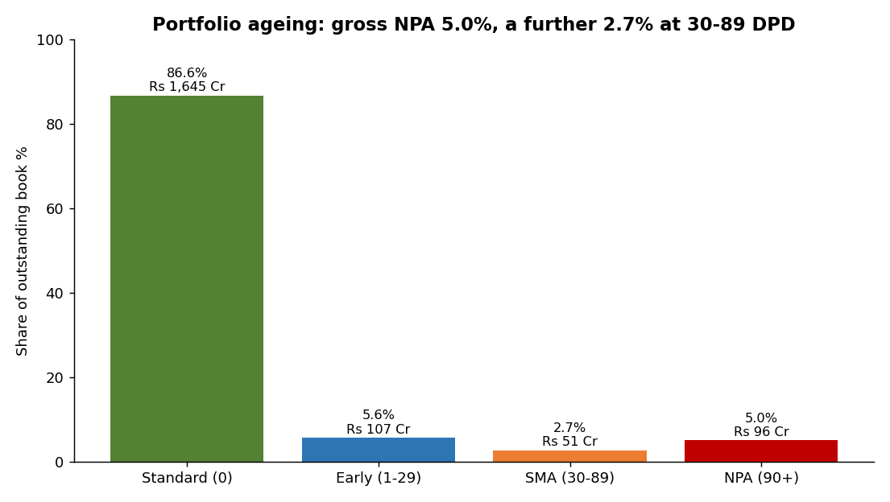
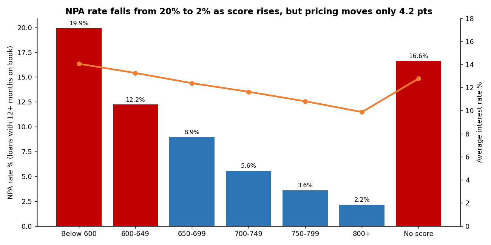
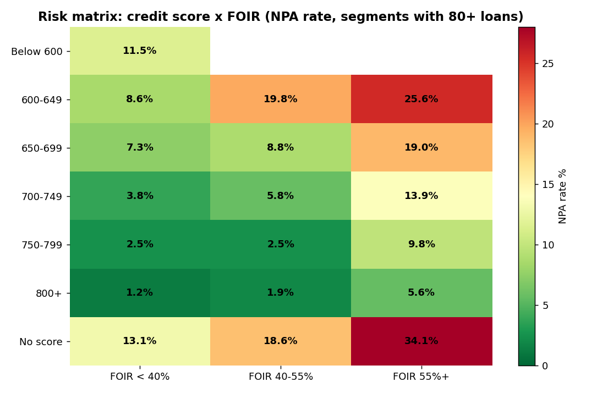
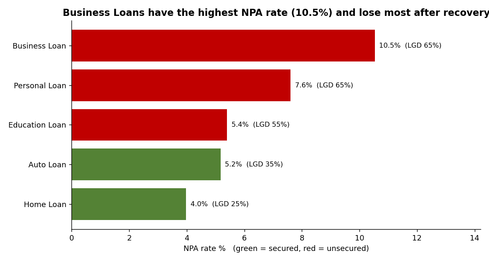
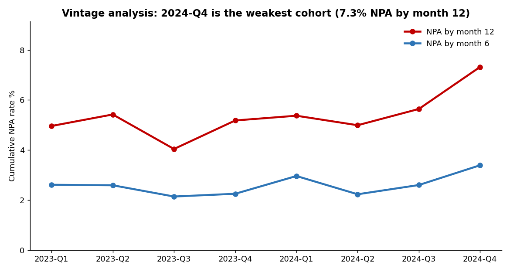

# Loan Portfolio & Credit Risk Analytics
**Python · SQL (SQLite) · Excel · Power BI**

An end-to-end analytics project on a retail-lending book: from messy raw application data to cleaned star-schema tables, 22 SQL risk queries, an Excel management dashboard and a Power BI-ready data model. It answers the questions a credit-risk or portfolio-MIS team asks every month: **who do we approve, who defaults, which segments are mispriced, and where should policy change?**

> **About the data:** real bank data is confidential, so the dataset is **simulated** (30,000 applications, Jan 2023 – Sep 2025, as of 31 Dec 2025) with a generator script (`src/01_generate_data.py`). The generator deliberately builds in realistic relationships (for example, lower credit scores default more) and then corrupts the raw file with real-world mess. The findings below therefore demonstrate the *analytical method*, not facts about any real lender. The pipeline works unchanged on a real portfolio with the same columns.



---

## Portfolio snapshot (as of 31-Dec-2025)

| Metric | Value |
|---|---|
| Applications | 30,000 |
| Approval rate | 60.0% |
| Amount disbursed | Rs 2,386 Cr |
| Live book (outstanding) | Rs 1,898 Cr |
| Gross NPA (90+ DPD) | 5.04% of book |
| Early delinquency (30–89 DPD) | 2.69% of book |
| Estimated credit loss (NPA × LGD) | Rs 39.4 Cr |
| Average interest rate | 11.53% |

## Pipeline

```
raw CSVs ──► 02 pandas cleaning ──► 03 SQLite star schema + views ──► 04 twenty-two SQL queries ──► 05 charts (matplotlib)
(messy)        data-quality report       fact + dim tables               CSV results                  06 Excel dashboard (live formulas)
                                                                                                    Power BI model (CSV export + DAX guide)
```

| Step | Script | What it does |
|---|---|---|
| 1 | `src/01_generate_data.py` | Builds the simulated portfolio and a deliberately messy raw file |
| 2 | `src/02_clean_data.py` | Cleans with pandas, writes `data_quality_report.csv` |
| 3 | `src/03_load_sql.py` | Creates the star schema, loads data, builds SQL views, exports Power BI CSVs |
| 4 | `src/04_run_sql_analysis.py` | Runs all 22 queries in `sql/analysis_queries.sql` |
| 5 | `src/05_eda_charts.py` | Produces 8 charts with data-driven titles |
| 6 | `src/06_build_excel_dashboard.py` | Builds the Excel dashboard (403 live formulas) |

## Run it

```bash
pip install -r requirements.txt
python run_all.py          # runs all six steps (about a minute)
```
Outputs land in `outputs/` (charts, query CSVs, Excel dashboard) and `powerbi/data/`.

## Data cleaning (raw → clean: 30,300 → 30,000 rows)

| Issue found in raw data | Rows | Fix |
|---|---|---|
| Mixed date formats (ISO, DD-MM-YYYY, DD/MM/YYYY) | 5,994 | Parsed into one date type |
| Inconsistent city names (Bangalore / Bengaluru, Gurgaon / Gurugram…) | 1,796 | Mapped to standard branch cities |
| Employment type spelling variants | 1,639 | Standardised to 3 categories |
| Duplicate application IDs | 300 | Kept first occurrence |
| Product name casing / trailing spaces | 448 | Standardised |
| Loan amount stored as text ("Rs. 450000", "4,50,000") | 426 | Stripped symbols, converted to numeric |
| Invalid credit scores (0, -1, 999) | 160 | Set to NULL (no bureau score) |
| Missing credit score (new-to-credit) | 2,308 | Kept NULL, analysed as its own "No score" band, never imputed |
| Missing monthly income | 435 | Median of same employment type, flagged |
| Impossible ages (<18 or >80) | 59 | Median imputation, flagged |

## Key findings

**1. The credit score separates risk strongly, but pricing barely follows it.** Loans with 12+ months on book (so segments are comparable) default at **19.9% below a score of 600 versus 2.2% at 800+**, yet the average interest rate differs by only **4.2 points** (14.1% vs 9.9%). Worth testing: for unsecured loans with ~65% loss-given-default, the sub-600 premium may not cover expected loss. *(Back-of-envelope: it ignores that NPA rates build over the loan's life.)*



**2. FOIR is the second powerful signal.** NPA rate rises from **4.2% (FOIR below 30%) to 15.3% (above 60%), 3.6× higher**. The score × FOIR risk matrix shows the worst cells: no-score borrowers with FOIR above 55% (**34.1% NPA**) and 600–649 scores with FOIR above 55% (**25.6%**).



**3. Business and Personal loans carry the most credit risk; Personal Loans earn the least after losses.** NPA rate: Business 10.5%, Personal 7.6%, Education 5.4%, Auto 5.2%, Home 4.0%. After credit losses, risk-adjusted return on disbursed amount is lowest for **Personal Loans (11.4%)** versus 13.4% for Education and 12.9% for Home.



**4. The DSA (agent) channel underperforms.** DSA-sourced loans have an NPA rate of **8.1% versus 5.5% for Branch** and 6.3% for Online, and the lowest risk-adjusted return (12.1% vs 12.9%). Self-employed borrowers sourced through DSAs are the riskiest channel-segment combination at 9.2%.

**5. The Jun–Dec 2024 vintage is weaker even though borrower quality did not change.** Its NPA rate by month 12 is **6.4% versus 5.0%** for other vintages, with an identical average credit score (735) and FOIR (0.36), pointing to underwriting, collections or macro factors rather than applicant mix.



**6. A blunt policy cut-off is expensive.** Simulating "reject if score < 650 or FOIR > 55%" on matured loans would reject 21.5% of the book and avoid 372 NPAs (43% of all NPAs), but would also turn away **2,431 good loans (Rs 518 Cr of business) to avoid Rs 18.9 Cr of estimated credit loss**. Targeted action on the worst matrix cells is a better first step.

**7. Geography.** Kolkata has the highest NPA rate (9.9%), then Gurugram (7.4%) and Delhi (7.3%). Delhi is also the largest city by disbursal (Rs 371 Cr), so its risk matters most in absolute terms.

### Recommendations
1. **Risk-based pricing** review for scores below 650 and no-score borrowers.
2. **Tighter FOIR exception rules** on unsecured products above 55%, especially combined with weak scores.
3. **DSA quality controls:** link partner payouts to 90-day repayment performance; tighten self-employed DSA sourcing.
4. **Collections focus on the 30–89 DPD bucket** (2.7% of book) before it rolls into NPA.
5. **Investigate the H2-2024 vintage** (underwriting changes, collections capacity, macro).
6. **Targeted rather than blanket tightening** (see the policy simulation, query 19).

## Excel dashboard
`outputs/excel/Loan_Risk_Dashboard.xlsx`: KPI cards, 4 charts and 4 analysis sheets. Every number is a **live formula** (COUNTIFS, SUMIFS, AVERAGEIFS, RANK) over the 30,000-row `Data` sheet, cross-checked against the SQL results.

## Power BI
`powerbi/data/` holds the star-schema CSVs; `powerbi/POWERBI_GUIDE.md` has the data model, 15 ready-to-paste DAX measures and a 3-page dashboard layout.

## SQL skills demonstrated
JOINs · GROUP BY / HAVING · CASE WHEN · CTEs · window functions (`LAG`, `RANK`, `NTILE`, `SUM() OVER`, moving averages) · views for business logic · cohort / vintage analysis · scalar subqueries · date functions · constraints and foreign keys.

## Repository structure
```
├── run_all.py
├── src/            6 pipeline scripts
├── sql/            schema.sql · views.sql · analysis_queries.sql (22 queries)
├── data/           raw/ and processed/ (+ data_quality_report.csv)
├── outputs/        images/ · query_results/ · excel/
├── powerbi/        data/ (star-schema CSVs) · POWERBI_GUIDE.md
└── docs/           data_dictionary.md
```

## Limitations
- Data is simulated; relationships were designed, so findings illustrate method rather than real-world truth.
- Loss-given-default values are assumptions by product type; interest earned is estimated from EMI and repayments, not a full cash-flow model.
- No predictive model is included; this project is descriptive and diagnostic analytics (a logistic-regression scorecard would be a natural extension).
